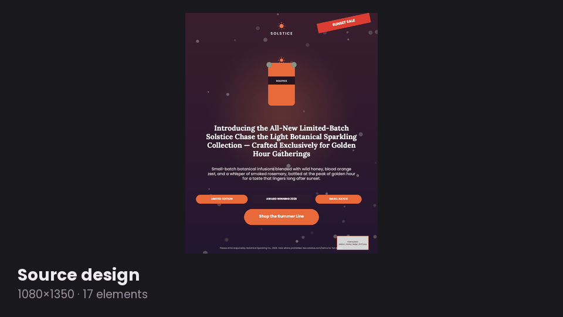
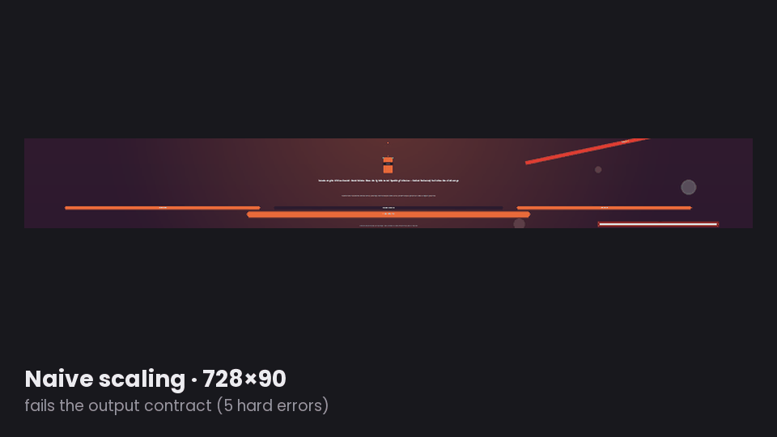
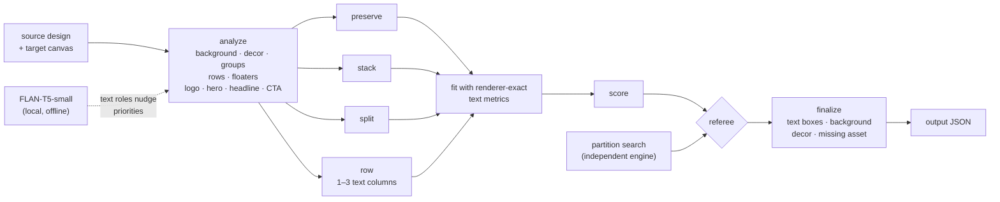
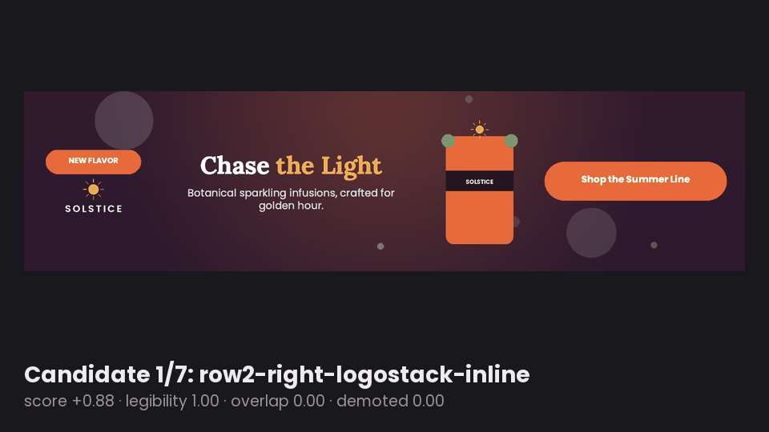
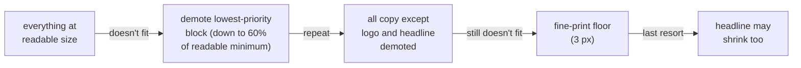
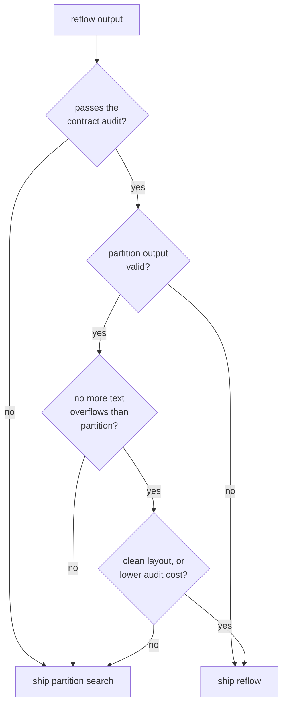

# Chameleon: structure-aware design resizing

`resize(source, target_canvas)` re-lays out a design (text, image and shape
elements) for a new canvas, such as a square post turned into a 728×90 leaderboard
or a 1080×1920 story. It runs fully offline in Docker, using a small local language
model and deterministic, renderer-exact layout search.

Only `x`, `y`, `width`, `height` and text `font_size` change. IDs, element count,
content, fonts, colours, opacity, z-order, groups, assets and image fit are
preserved exactly. Images keep their aspect ratio. Nothing is placed off-canvas.

<p align="center"></p>

*One 17-element design, re-laid out for ten real platform formats. Every frame is
the engine's actual output, rendered by the official cr-renderer
(`python -m scripts.make_readme_media` regenerates all the animations here).*

## Why not just scale it?

<p align="center"></p>

Scaling every box by the canvas ratio squashes images, piles text on top of
itself and pushes copy off the canvas. On all three official samples, naive
scaling **fails the output contract**. The captions in each frame are the
contract audit's own findings for that output.

## Approach




**1. Understand the design.** Elements arrive with no semantic labels, so
`engine/analyze.py` infers structure from geometry and styling:
- backgrounds and faint decorative shapes
- explicit groups, plus implicit buttons (text sitting on a shape)
- rows of related elements, and corner badges or ribbons ("floaters")
- the logo, the hero image, the headline and the call to action
- a priority for every block

A local FLAN-T5-small model labels each text as headline, body, CTA, legal or
label. Its labels only nudge priorities: legal copy becomes less important, and
CTA text helps pick the button. Geometry makes the decisions.

**2. Generate genuinely different layouts.** `engine/layout.py` builds
candidates of four kinds:
- **preserve:** the original composition, rescaled
- **stack:** a single column
- **split:** hero image beside a text column
- **row:** a banner with 1–3 content-weighted text columns

Each is fitted at the largest scale that works. Text is measured with the same
font files and greedy wrap routine as the official renderer, so the chosen font
sizes really fit their boxes. Groups such as buttons and badges stay rigid, and
their labels shrink to fit. On very small canvases, the least important copy is
demoted to fine print rather than hidden or removed.

<p align="center"></p>

*The real candidates generated for the level 2 sample at 1600×400, worst to best,
with their actual scores. The search ends on the layout it ships.*

When nothing fits at a readable size, copy is demoted step by step, least
important first. Nothing is ever hidden or deleted:



**3. Score and pick.** Candidates are scored on:
- importance-weighted legibility
- visible overlap
- element-box overlap
- canvas coverage
- out-of-bounds placement

**4. Referee.** `engine/resize.py` also runs an independent grid/partition
search and keeps whichever output passes the contract audit
(`evaluation/audit.py`) with fewer problems. The structure-aware engine wins in
about 96% of stress cases. The partition search is a safety net for extreme
shapes.



**5. Finalize.** `engine/reflow.py` adjusts the final output:
- Text boxes are reconciled with measured text, and rotated text is kept inside
  the canvas.
- The background is re-fitted.
- Decorations are moved away from content.
- A missing-asset image would render as a grey placeholder. It can't be removed
  without breaking the ID contract, so it is tucked behind an opaque element.

## Run

```
docker build --platform linux/amd64 -t chameleon .
docker run --rm --network none \
  -v $(pwd)/input:/app/input -v $(pwd)/output:/app/output chameleon
```

For every `input/*.json` task, this writes `<task>_output.json` and
`<task>_output.png`, rendered with the official cr-renderer. The build downloads
the pinned model weights and pinned cr-renderer once. Running needs no network.

**Locally:** use Python 3.11.

```
python -m venv .venv && .venv/bin/pip install -r requirements-dev.txt -r requirements-model.txt
.venv/bin/python -m scripts.prepare_flan        # one-time model download
.venv/bin/python -m engine.main --input input --output output
```

## Verification

- **Unit tests:** `pytest -q` runs 103 tests: contract invariants, mutations
  (renamed IDs, long copy, rotation), extreme aspect ratios, an official-renderer
  round trip and live model integration.
- **Benchmark:** `python -m evaluation.run --split {samples,dev,holdout}` runs a
  contract audit plus an HTML gallery of source, naive stretch and result.
  - Samples: 3/3 valid, 0 text overflows.
  - Dev and holdout: 72/72 valid each, 0 overflows.
  - The naive stretch is valid in only 4/72 dev cases.
- **Stress:** 10,573 cases (the 3 samples, their mutations and 200 synthetic
  designs, each at 35 targets from 50×50 to 4000×4000):
  - 0 crashes, 0 invalid outputs, no image shrunk below visibility
  - outputs identical on every rerun (deterministic)
- **Docker:** the image builds, and runs with `--network none` exactly as above.
  The model is used for every task. The 3 samples and the samples at 15 real
  platform formats (Instagram, Story, YouTube, LinkedIn, IAB ad sizes and more) are
  all valid, 51/51.

These are local proxies. They are not the organizers' AI evaluation.

### What stress testing caught

Each bug below was found by the stress run, fixed, and re-verified on all cases:

| Symptom | Cause | Fix |
|---|---|---|
| Long copy fell back to an overlapping layout | the scale search assumed "fits at a large scale" implies "fits at a small one", which is false for buttons with long labels | scan down for the largest scale that actually fits |
| Rotated headline outside a 2000×90 banner (hard contract failure) | final pass ignored the rotated footprint | shrink rotated text until its rotated box fits |
| Grey missing-asset placeholder visible on 320×50 | fallback output never hid it | hide the placeholder in every output |
| Product image shrunk to 0.3 px | images were the only thing allowed to shrink | minimum visible image size |
| Font sizes like `23.7` | renderer draws `int(font_size)`, so measured ≠ drawn | whole-pixel font sizes |
| Headline box doubled in height inside Docker only | Docker's skia build measures about 1% wider, so tightly sized text wrapped a word early | widen the box a few percent before adding a line |

## Known limits

- On very small banners (320×50, 72×90), long copy can only fit as fine print.
- The FLAN role labels are noisy, so they are used only as a light hint.
- Natively, a design takes about 0.2 s on average and about 1 s for the most
  complex sample, plus a one-time model load of a few seconds. Under amd64
  emulation on Apple silicon (Colima/qemu), the 48 platform-format tasks took
  about 7 s each.

## Files

- `engine/resize.py`: public `resize()` contract, partition search, referee.
- `engine/analyze.py`, `layout.py`, `reflow.py`, `measure.py`: structure-aware engine.
- `engine/local_model.py`: local FLAN-T5 role labels.
- `engine/main.py`: batch entrypoint used by Docker.
- `evaluation/`: contract audit, synthetic cases, review gallery.
- `tests/`: test suite.
- `addon/`, `engine/service.py`: Express preview panel (see `docs/EXPRESS.md`).
- `docs/`: architecture notes, results, requirements mapping, pitch.
